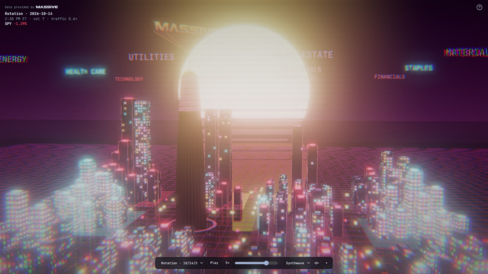

# Market City



The stock market as a city you can read from across the room. Each tower is one of the 18 largest S&P 500 stocks in its sector, and every light, color and sound in the scene comes from live market data. Data comes from [Massive](https://massive.com).

## How it works

**Districts** are sectors. Each tower is one of the 18 largest S&P 500 stocks in its GICS sector. Height follows the square root of market cap.

**Lit windows** show how the stock is doing today. A dark tower is down, a fully lit one is up.

**Edges, beacons and signs** take the up color or the down color. Brighter means a bigger move.

**The tall tower** in the open plaza is SPY, the whole market. Its crown glows with SPY's move, and the LED bands scroll up or down with it.

**Weather** follows SPY volatility over the last 20 minutes: clear, haze, rain, then lightning.

**Sky** drifts from dusk at the open to night at the close. It warms when SPY is up and goes cold when SPY is down.

**Traffic** follows SPY volume against its 20-day minute average.

**Fireworks** They launch when a stock crosses another +5%, a sector another +2.5%, or SPY another +2%. SPY's are the big ones from the tall tower.

**Sound** follows the same data. Tempo is traffic, hi-hats and swing are volatility, the key is SPY direction, the bass filter opens with the size of SPY's move, and the arpeggio steps through the 11 sectors.

Hover a tower for the numbers. Drag to orbit, pinch or ⌘-scroll to zoom, right-drag to pan. WASD moves around the city, Q and E turn, Shift goes faster. Double-click resets the view. F is full screen, H hides the controls and M mutes.

## Music

**The music is made live from the market.** Nothing is pre-recorded. Tone.js plays it in the browser from the same data that drives the city.

**Tempo** follows traffic. A busy market plays faster, inside each genre's tempo range.

**Hi-hats and swing** follow volatility. A calm day has sparse hats. A volatile one gets busy and loose.

**The key** comes from SPY's direction when a song starts: bright on an up day, dark on a down day. The song keeps that key to the end.

**The bass filter** opens as SPY's move grows, so a big day sounds wide open and a flat day sounds muffled.

**The arpeggio** steps through the 11 sectors. Each note is a tone of the current chord. Bigger moves play higher notes, down sectors play an octave lower, and quiet sectors rest.

**Thunder** rolls in when lightning strikes, and fireworks pop.

**Songs** have a form that fits the genre, end on their own, and hand over to a new song with a new seed. The mix sits low, as a background bed. The speaker icon or M mutes it.

## Themes

Each theme has its own look and plays its own genre.

| Theme | Genre | Tempo | What you hear |
|---|---|---|---|
| Cyberpunk | Techno | 124–134 | Four-on-the-floor kick, off-beat open hats, chord stabs, an FM arp |
| Dusk | Deep house | 118–124 | Swung hats, electric piano 7th chords on an i7–IV7 vamp, a warm rolling bass |
| Synthwave | Synthwave | 84–112 | A 16th-note arpeggiated bass with sidechain pumping, gated snare, tom fills, lots of arp, a slow lead in the chorus |
| Noir | Trip-hop | 72–90 | A laid-back broken beat, swung 8th hats, electric piano chords, vinyl crackle |
| Matrix | Industrial techno | 130–145 | A distorted kick and a bit-crushed arp |

## Days

The default view is today. During market hours it runs live and refreshes every 30 seconds. After the close it replays today's session. Before the open, and on weekends, it shows the last full session. The Examples menu has fixed sample days: a calm one, the April 4, 2025 crash, the April 9, 2025 rally, and a sector rotation day.

## Running it

You need a Massive API key on Stocks Starter or above. Starter and Developer data is 15 minutes delayed, and the page labels it that way. Real-time needs Stocks Advanced or a business plan. The free Stocks Basic plan allows 5 calls a minute and has no snapshots, so it can't run the city. The key stays on the server. The page only ever calls `/api/today`, never Massive directly.

```bash
cp .env.example .env.local
```

Put your key after `MASSIVE_API_KEY=` in `.env.local`, then start the server (Node 22.9 or later):

```bash
npm start
```

Open http://localhost:8811. To use another port, set `PORT`, for example `PORT=3000 npm start`. Add `?sound=0` to the URL to start silent for screenshots or embeds.

## Hosting

The code that talks to Massive lives in `lib/today.mjs`, and each host wraps it.

**Any Node host** (Railway, Render, a VPS): run `npm start` with `MASSIVE_API_KEY` set in the host's environment. `server.mjs` serves the page and the API from one process and keeps today's session in memory.

**Docker** (Fly.io, or any container host): `docker build -t market-city .`, then run it with `-e MASSIVE_API_KEY=...` and port 8811.

**Vercel**: import the repo and add `MASSIVE_API_KEY` as an environment variable. The page is served as static files and `api/today.mjs` runs as a function. The session lives in the Vercel Runtime Cache, and the CDN keeps each response for 25 seconds, so a crowd of viewers shares about two function calls a minute.

The session refreshes on demand: a request that finds the data older than a minute refreshes it with one Massive snapshot call. Building a new day takes about 210 calls, once per day.

## Data

The repo holds no market data. `universe.json` lists the sectors, the 18 tickers in each, and the sample dates. The server builds the sample days and the market caps from your Massive key on the first request, about 1,050 calls, and caches them for a year. The live day costs about 210 calls to build, then one snapshot call a minute while the market is open, and nothing outside market hours.

`constituents.json` is the S&P 500 with GICS sectors, from Wikipedia's list of S&P 500 companies. The 18 tickers per sector are the largest by market cap.
